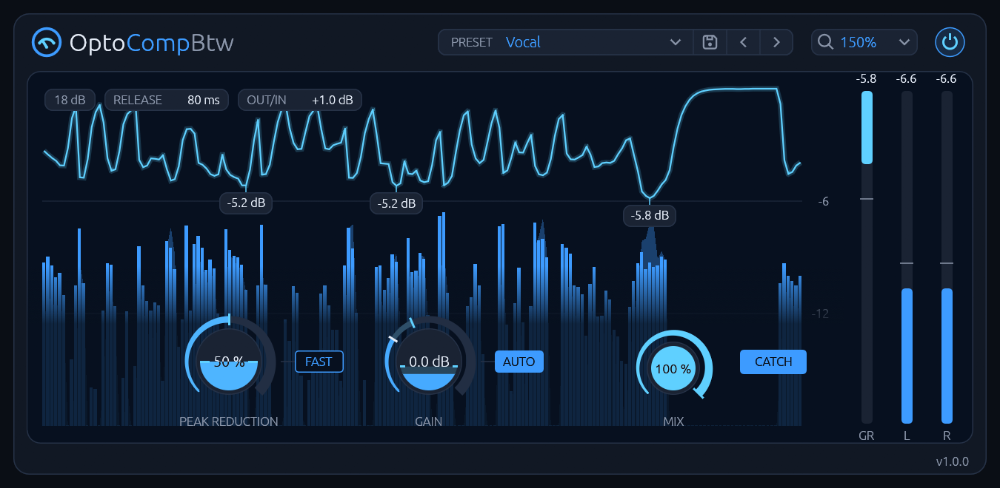

# OptoCompBtw

**An optical leveller: one knob for how hard it squeezes, its gain made up for you.** A light
cell rides a vocal, a bass or a bus smoothly, and a display shows every decibel it takes. CLAP for
Linux.



**[OptoCompBtw on jelly-comet.github.io](https://jelly-comet.github.io/plugins/optocompbtw/)**: more screenshots, the manual to read or as a PDF, and every release.

OptoCompBtw is a compressor of the slow, smooth kind. A light cell lit by the signal pulls the
level down, catches a peak in a few milliseconds and lets go over tens of milliseconds after a word
or seconds after a long loud passage, so it levels without sounding pumped. Turn PEAK REDUCTION and
AUTO GAIN keeps the loudness about where it was, so you hear the levelling and not a louder signal.
Two transformers and a tube stage colour it a little. FAST swaps in a quicker cell for drums and
bass, CATCH adds a fast compressor for the spikes the cell lets through, and MIX blends in the dry
signal. It has no latency. It is not a limiter and not a multiband compressor: one gain for the
whole signal.

**[Read the manual](manual.md)** for every control and how to use it.

## What it's for

- **Vocal levelling:** even out a sung or spoken take so every line sits at the same level, with CATCH for the
  plosives and shouts.
- **Bass compression:** hold a bass guitar or a synth bass steady under the mix, with FAST for a quick attack.
- **Parallel drum compression:** squeeze drums hard and blend them under the dry ones with MIX.
- **Gentle bus glue:** a little levelling on a group or the mix bus.

## Features

- **One knob for the squeeze:** PEAK REDUCTION, with the release following the music: tens of milliseconds after a
  word, seconds after a long loud passage.
- **AUTO GAIN:** the makeup follows PEAK REDUCTION, so turning it doesn't make it louder. GAIN adds to it, or makes up
  all of it with AUTO off.
- **FAST:** a quicker cell, 11.7 dB down 1 ms after a hit where the slow cell is 1.4 dB down.
- **CATCH:** a fast compressor ahead of the cell (−10 dBFS, 4:1); under its threshold the sound is untouched.
- **MIX** for parallel compression, the levelled and the dry signal in phase.
- **A display that shows what it does:** the last 8 seconds of input, output and the reduction, the knobs on it,
  meters beside it, the release the cell is on now and OUT/IN, the output's loudness against the input's, which a
  click makes up.
- **A little colour:** two transformers and a tube stage, 0.5 % THD at a normal level.
- **No latency.**
- **Presets:** five built in beside Default, and your own; a preset never changes GAIN.
- **Light:** 0.59 % of a CPU core at the defaults, stereo at 48 kHz.
- **Zoom** from 100 to 200 %.
- **No network access and no telemetry.**

## Install

Download the latest version from the [Releases page](https://github.com/jelly-comet/OptoCompBtw-release/releases),
or with these commands:

```bash
curl -LO https://github.com/jelly-comet/OptoCompBtw-release/releases/download/v1.0.0/OptoCompBtw-1.0.0-linux-x86_64.tar.gz
curl -LO https://github.com/jelly-comet/OptoCompBtw-release/releases/download/v1.0.0/OptoCompBtw-1.0.0-linux-x86_64.tar.gz.sha256
sha256sum -c OptoCompBtw-1.0.0-linux-x86_64.tar.gz.sha256 && tar xzf OptoCompBtw-1.0.0-linux-x86_64.tar.gz
cd OptoCompBtw-1.0.0-linux-x86_64
```

Install for your user:

```bash
mkdir -p ~/.clap
rm -f ~/.clap/OptoCompBtw.clap && cp OptoCompBtw.clap ~/.clap/
```

Or for all users:

```bash
sudo mkdir -p /usr/lib/clap
sudo rm -f /usr/lib/clap/OptoCompBtw.clap && sudo cp OptoCompBtw.clap /usr/lib/clap/
```

Removing the old copy first avoids overwriting a file a running host has loaded. Then rescan plugins
in your DAW.

To uninstall:

```bash
rm -f ~/.clap/OptoCompBtw.clap
```

Your presets stay in `~/.local/share/OptoCompBtw/presets/`; delete that folder too if you want them gone.

## Requirements

- Linux x86-64 on a CPU with AVX2 (Intel Core from 2013, AMD from 2015), with glibc 2.31 or newer (Ubuntu 20.04, Debian 11, Fedora 32 and newer)
- A CLAP host. Tried in REAPER.
- X11 or XWayland, and a Vulkan driver for the editor

Releases contain the CLAP plugin only.

## FAQ

### Is it free?

Yes. The download is free and MIT-licensed.

### Is there a VST3 or LV2 version?

No. Releases contain the CLAP plugin only.

### Does it run on ARM, like a Raspberry Pi or Apple Silicon?

No. It needs Linux on x86-64, on a CPU with AVX2.

### Which hosts does it work in?

Any CLAP host. It was tried in REAPER.

### Does it work on Wayland?

Through XWayland. The editor also needs a Vulkan driver.

### Can I use it as a limiter on the master?

Not as a brickwall limiter: it levels slowly and smoothly, and a fast peak can get through. CATCH lowers the
spikes, but put a limiter after it if nothing may pass 0 dBFS.

## License

MIT, see [LICENSE](LICENSE). The licenses of the third-party code in the binaries are in
`THIRD-PARTY-LICENSES.txt` in each release archive.

VST is a registered trademark of Steinberg Media Technologies GmbH. CLAP is an open standard by the
free-audio project. OptoCompBtw is an independent project, not affiliated with or endorsed by the
makers of any other compressor, and it models no particular unit.
