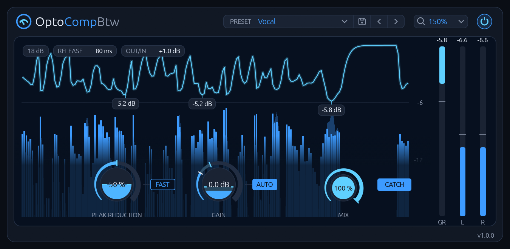
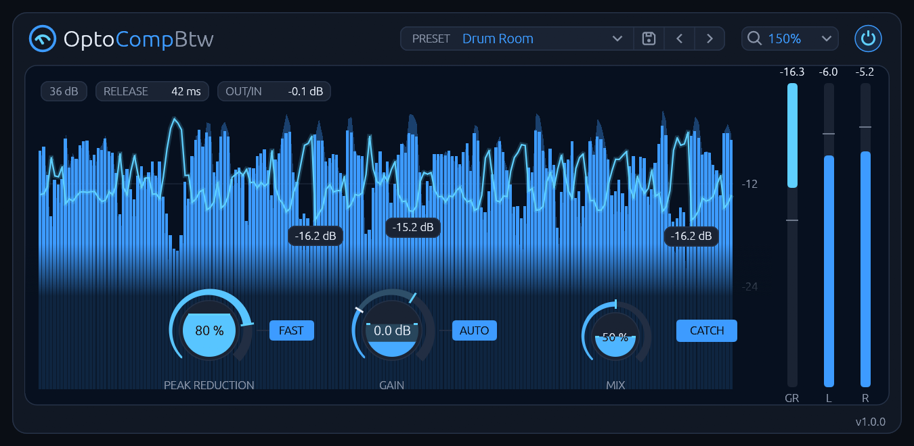

# OptoCompBtw manual

**An optical leveller: one knob for how hard it squeezes, its gain made up for you.** A light
cell rides a vocal, a bass or a bus smoothly, and a display shows every decibel it takes.

Version 1.0.0. To install it, see the [install steps](README.md#install).

## Contents

- [Getting started](#getting-started)
- [The controls](#the-controls)
- [How to use it](#how-to-use-it)
- [Good to know](#good-to-know)
- [Troubleshooting](#troubleshooting)

## Getting started

Put OptoCompBtw on a vocal, a bass or a group and play it. At the defaults (PEAK REDUCTION 40 %,
AUTO on) it is already levelling: the display shows the input, the output and, from the top down,
the reduction. Turn PEAK REDUCTION up until the loud parts come down as far as you want; AUTO keeps
the loudness about where it was, so compare by ear with the power switch at the top right.

## The controls

From the top left of the window.

| Control | Range | Default | What it does |
| --- | --- | --- | --- |
| **PRESET** | a list | Default | See [Presets](#presets). |
| **Zoom** | 100 to 200 % | 100 % | The window's size, kept with the project. |
| **Power switch** (top right) | on, off | on | Off, the input passes untouched, crossfaded over 20 ms. |
| **Display scale** (top left of the display) | 9, 18, 36 dB | 18 dB | How much reduction the display shows, kept with the project. |
| **RELEASE** (readout) | | | The release the cell is on now. |
| **OUT/IN** (readout) | | | The output's loudness against the input's. A click sets GAIN to make up the difference, once. |
| **PEAK REDUCTION** | 0 to 100 % | 40 % | How hard it squeezes. |
| **FAST** (off PEAK REDUCTION) | off, on | off | A quicker cell in place of the slow one. |
| **GAIN** | −12 to +30 dB | 0.0 dB | On top of AUTO's makeup, or all of it with AUTO off. Its ring shows what AUTO adds. |
| **AUTO** (off GAIN) | off, on | on | The makeup follows PEAK REDUCTION. |
| **MIX** | 0 to 100 % | 100 % | The levelled signal against the dry one. |
| **CATCH** | off, on | off | A fast compressor ahead of the cell, for spikes. |
| **GR, L, R** (meters) | | | The reduction now, and the output's level on each side. |

**Mouse:** drag a knob up or down; hold Shift for fine steps; the scroll wheel steps; double-click
resets to the default; right-click a value to type it. The host can automate every parameter.

## How to use it

### PEAK REDUCTION and the cell

The cell is lit by the signal and darkens slowly. It catches a peak in a few milliseconds and lets
go over tens of milliseconds after a short sound, but over seconds after a long loud passage. That
is what makes it smooth: short words come back up quickly, while a loud chorus is held down evenly
instead of pumping. PEAK REDUCTION sets how hard it squeezes. Around 30 to 50 % evens out a vocal;
70 % and up is heavy compression.

The RELEASE readout shows which release the cell is on now, so you can see it slow down through a
loud passage.

### AUTO and GAIN

With AUTO on, the makeup follows PEAK REDUCTION, so turning it changes how levelled the sound is
and not how loud. GAIN adds to that; its ring shows how much AUTO is adding. With AUTO off, GAIN
alone makes up the level, up to +30 dB.

OUT/IN reads the output's loudness against the input's, measured while the window is open. Click it
and GAIN moves to make the two match, as one undo step: a quick way to compare fairly.

### FAST

FAST swaps the slow cell for a quicker one: 11.7 dB down 1 ms after a hit from silence, where the
slow cell is 1.4 dB down, and it lets go about as fast after a long passage as after a short one.
Reach for it on drums, plucked bass and anything with sharp attacks the slow cell lets through.

### CATCH

CATCH puts a fast compressor (−10 dBFS, 4:1) ahead of the cell, for the spikes the cell is too slow
for: a plosive, a shout, a snare hit. Below −10 dBFS it does nothing at all. On drums at a normal
level it lowers the peaks by about 4 dB. AUTO doesn't count what CATCH takes, so the sound gets
about 1 dB quieter with it on; click OUT/IN to make that up.

### MIX: parallel compression

MIX blends the levelled signal with the dry one, kept in phase, so you can squeeze hard and keep
the dry hits on top. Drum Room and Parallel Squash start there.

### The display

The last 8 seconds: the input behind, the output in front and the reduction as a line from the top,
with its deepest points marked. If the reduction runs off the bottom, set the scale at the top left
to 36 dB; for gentle levelling, 9 dB shows it in detail.

### Presets

The PRESET list holds Default, your favourites, the other built-in presets and then your own. The
arrows step through them, the disk saves the current settings under a name, and the list searches,
stars and deletes your own. A preset holds PEAK REDUCTION, AUTO, MIX, FAST and CATCH, never GAIN or
the power, so a preset never makes your track jump in level.

| Preset | PEAK REDUCTION | MIX | FAST | CATCH | For |
| --- | --- | --- | --- | --- | --- |
| Default | 40 % | 100 % | off | off | Anything, as a start. |
| Vocal | 50 % | 100 % | off | on | A lead vocal, spikes caught. |
| Bass | 55 % | 100 % | on | off | Bass guitar or synth bass. |
| Drum Room | 80 % | 50 % | on | on | Drums or a room mic, parallel. |
| Gentle Bus | 25 % | 100 % | off | off | A group or the mix bus. |
| Parallel Squash | 100 % | 35 % | on | on | Heavy parallel compression. |

Your presets are text files in `~/.local/share/OptoCompBtw/presets/`, shared by every project.

## Good to know

- **No latency:** nothing for the host to compensate.
- **Mono or stereo:** both channels are levelled by one gain, so the stereo image stays put.
- **Light:** 0.59 % of a CPU core at the defaults, stereo at 48 kHz, a little more with the window
  open.
- **Click-free changes:** knob moves glide over 20 ms, so you can automate them.
- **Colour:** two transformers and a tube stage add 0.5 % of harmonics on a 1 kHz tone at −18 dBFS
  RMS, more as GAIN rises. The tube runs without oversampling, for the zero latency: a very high,
  loud tone aliases a little (−46 dB on 15 kHz at a normal level).
- **Not a limiter:** a fast peak can get past the cell. Put a limiter after it if nothing may pass
  0 dBFS.

## Troubleshooting

- **The plugin doesn't show up:** check that the bundle is in `~/.clap` or `/usr/lib/clap`, then
  rescan plugins in your DAW. It needs a CPU with AVX2.
- **The editor window stays black or doesn't open:** check that a Vulkan driver is installed. The
  `vulkaninfo` tool from `vulkan-tools` should list your GPU.
- **It gets quieter with CATCH on:** AUTO doesn't count CATCH's reduction. Click OUT/IN.
- **The reduction runs off the display:** set the display's scale to 36 dB.
- **OUT/IN shows nothing:** it needs a second of sound with the window open.
- **A preset doesn't show up in the menu:** its file must end in `.preset`, and its name can't be a
  built-in preset's. The editor reads the folder when it opens and after a save, so reopen it after
  adding files by hand.
